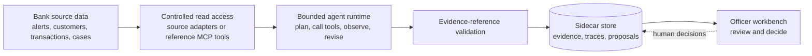

# ARIA

**An auditable AI investigation sidecar for anti-money laundering teams.**

[](https://github.com/zohidjon-m/aria/actions/workflows/ci.yml)
[](LICENSE)

ARIA turns transaction-monitoring alerts into evidence-linked investigation
proposals. It brings together customer history, transaction patterns, screening
results, and money-flow analysis so a compliance officer can review what the
system found, how it reached its recommendation, and what still needs attention.

The project combines a Python agent runtime, a FastAPI backend, a reference
Model Context Protocol (MCP) server, and a React analyst workbench. Agents read
through controlled tools; generated evidence, traces, and proposals live in a
separate sidecar store.

**Agents investigate and propose. Humans decide.**

**Status:** Public alpha with a local demo. Production controls and bank-specific
outcome evaluation remain work in progress.

[Try the demo](#try-the-demo) · [Architecture](#architecture) ·
[Engineering decisions](#engineering-decisions) · [Code tour](#code-tour) ·
[Tests](#tests-and-verification)

## The problem

An alert is the start of an investigation. An analyst still needs to establish
whether a transaction fits the customer's normal behavior, examine related
activity, check risk signals, and document the decision. That work crosses
multiple records and systems.

ARIA adds an investigation and explanation layer around those sources. Its
central engineering question is: **how can an agent help investigate an alert
while keeping data access bounded, conclusions traceable, and final decisions
with the officer?**

## What it does

| Workflow | What the reviewer receives |
| --- | --- |
| **Alert triage** | A recommendation to investigate, escalate, or review as a likely false positive, with reasons and evidence references. |
| **Investigation** | Typology signals for structuring, velocity, geography, sanctions, and politically exposed persons (PEPs), plus bounded counterparty and money-flow tracing. |
| **Customer risk scoring** | A proposed risk level with contributing factors; the live MCP workflow keeps the final score deterministic. |
| **Suspicious Activity Report (SAR) drafting** | A narrative for human review; the live MCP workflow includes sentence-level evidence links and missing-field reporting. |
| **Review and audit** | A workbench for inspecting proposals, tool calls, runtime events, and evidence, with separate officer decisions and explicit export records. |

## Try the demo

### Full analyst workbench

Requires Docker with Compose. From the repository root:

```bash
docker compose up --build
```

This starts PostgreSQL 16, seeds demo banking data on first launch, starts the
FastAPI workbench backend, and serves the React UI.

- [Open the workbench](http://localhost:5173)
- [Explore the API docs](http://localhost:8000/docs)

Start in the alert queue, open an alert, and run agent triage. Inspect the
recommendation, evidence, and execution trace. Customer and case pages expose
risk-scoring and SAR-review workflows; live MCP actions require LLM configuration.

The default heuristic triage path needs **no LLM API key**. Compose credentials
are for local demo use. See [Docker setup](DOCKER.md) for configuration and
troubleshooting.

### Core Python demo

Run the sidecar against built-in fixtures without Docker, PostgreSQL, or an LLM
key. Python 3.10+ is supported; CI uses Python 3.12.

```bash
python -m venv .venv
source .venv/bin/activate
python -m pip install -e . -r requirements.txt
python scripts/smoke_test.py
```

On Windows PowerShell, replace the first two commands with:

```powershell
py -3.12 -m venv .venv
.\.venv\Scripts\Activate.ps1
```

The smoke test runs triage, risk scoring, and SAR drafting, validates the outputs,
and persists them to a temporary SQLite sidecar database. Expected output
(followed by the database path):

```text
triage: escalate passed
risk: critical passed
sar: draft_for_human_review passed
```

To explore the standalone API, use `DEMO_MODE=true` and `PLANNER_TYPE=heuristic`
in your environment, then run:

```bash
python scripts/run_demo_api.py --port 8000
```

Open [the interactive API docs](http://localhost:8000/docs), or try:

```bash
curl -X POST http://localhost:8000/api/alerts/1001/triage
curl -X POST http://localhost:8000/api/customers/501/risk-score
curl -X POST http://localhost:8000/api/cases/9001/sar-draft
```

Each response includes a `run_id`, a structured `result`, and a `validation`
report. Retrieve the persisted record with `GET /api/sidecar/runs/{run_id}`.

The standalone sidecar and Docker workbench are separate API entrypoints with
different route sets. Run one at a time on port 8000.

## Architecture

ARIA uses a **modular sidecar monolith**: source access, agent execution,
validation, and persistence have explicit internal boundaries without requiring
a distributed agent platform for local evaluation.



The default triage path proceeds in five stages:

1. **Establish context.** Load the alert, customer, and transaction context and
   derive a bounded investigation scope.
2. **Pre-screen.** Compare activity against behavioral baselines and risk
   signals. Clear-cut cases produce a review proposal without entering the
   planning loop.
3. **Investigate ambiguity.** Route relevant typologies and run a bounded
   plan–tool–observe–revise loop with a heuristic or optional LLM planner.
4. **Validate references.** Check that structured claims and reasoning cite
   evidence present in the run. Failed validation is recorded and flagged.
5. **Persist for review.** Save the proposal, evidence, confidence factors, and
   available execution trace. Officer decisions are recorded separately.

The separate live MCP path supports triage, investigation, risk scoring, and SAR
drafting through an LLM planner and a reference read-only tool server. Its
explicit state machine records planning, tool execution, observations, hypothesis
updates, validation, and terminal outcomes.

See the [architecture](docs/architecture.md), [agent loop](docs/agent-loop.md),
and [sidecar design decision](docs/adr-001-sidecar-monolith.md) for more detail.

## Engineering decisions

| Decision | Implementation and rationale |
| --- | --- |
| **Separate source data from agent artifacts** | The [PostgreSQL adapter](src/compliance_agent/adapters/postgres_source.py) uses read-only sessions and parameterized queries. The [sidecar store](src/compliance_agent/adapters/sidecar_store.py) persists generated records separately. Agents do not generate arbitrary SQL or write to bank source systems. |
| **Use deterministic policy around agent planning** | The [pre-screen gate](src/compliance_agent/agents/pre_screen.py) handles clear-cut cases; the [typology router](src/compliance_agent/agents/typology_router.py) narrows tools for ambiguous investigations. Routine policy stays explicit and inspectable. |
| **Enforce tool boundaries in code** | The [reference MCP service](mcp_server/service.py) validates typed requests, checks investigation scope, and bounds row counts, lookbacks, and graph traversal. Shared [contracts and JSON schemas](contracts/) make the integration boundary reviewable. |
| **Make failure a first-class outcome** | The [live MCP runtime](src/compliance_agent/agents/live_mcp_demo.py) records terminal stop reasons. Tool denial, malformed output, missing evidence, timeout, and exhausted execution budgets produce a fail-safe investigation outcome. Critical signals trigger escalation. |
| **Keep evidence and confidence inspectable** | The [validator](src/compliance_agent/agents/validation.py) checks source-reference coverage for claims and structured reasoning. The default triage [confidence engine](src/compliance_agent/agents/confidence.py) derives scores from runtime signals and records factor adjustments. |
| **Preserve the review history** | Sidecar persistence records runs, tool observations, hypotheses, graph paths, and runtime versions. The [review API](backend/routes/agent_runs.py) and [React review panel](frontend/src/components/AgentReviewPanel.jsx) keep proposals, human decisions, and export records distinct. |

The agent's read-only boundary applies to investigation tools. The reference
workbench also has officer-initiated workflow writes with permission checks and
audit records; those are separate from agent execution.

## Code tour

```text
src/compliance_agent/   Core Python package: orchestration, agents, adapters, API
backend/               Workbench API, officer permissions, review and audit routes
frontend/              React workbench: alerts, customers, cases, graphs, traces
mcp_server/            Reference read-only MCP server and demo fixtures
contracts/             Generated JSON schemas and tool catalogs
tests/                 Unit, workflow, contract, and failure-path tests
sql/                   Sidecar schema
docs/                  Architecture, integration, design decisions, readiness
```

**Stack:** Python · FastAPI · Pydantic · MCP · PostgreSQL · SQLite ·
React 19 · Vite · Tailwind CSS · Docker Compose · GitHub Actions.

For a focused code review, start with the
[orchestrator](src/compliance_agent/orchestrator.py), follow the
[bounded triage runtime](src/compliance_agent/agents/react_runtime.py), then
inspect the [acceptance tests](tests/test_phase12_acceptance.py) and
[live MCP workflow tests](tests/test_phase4_live_mcp_workflows.py).

The Python distribution is `aria-aml`; the import package is `compliance_agent`.

## Tests and verification

Run the Python suite from the repository root:

```bash
python -m unittest discover -s tests
```

Coverage includes scope escape attempts, tool allowlists, graph bounds,
malformed planner output, fail-safe stopping, evidence validation, confidence
factors, trace persistence, officer permissions, and human-review workflows.
LLM behavior is mocked in the default suite, so tests do not require cloud keys.

Frontend checks (Node.js 22 is used in CI):

```bash
cd frontend
npm ci
npm run lint
npm run build
```

[GitHub Actions](.github/workflows/ci.yml) runs the Python suite and frontend
lint/build checks on pushes and pull requests. These checks verify implementation
behavior; they do not establish AML detection accuracy or live provider quality.

## Configuration and integration

Start with [`.env.example`](.env.example). Key settings:

- `DEMO_MODE`, `BANK_SOURCE_DSN`: built-in fixtures or PostgreSQL source data.
- `SIDECAR_DB_PATH`: SQLite storage for generated artifacts.
- `PLANNER_TYPE`: `heuristic` by default; `llm` enables LLM planning in the
  standard triage runtime.
- `LLM_API_KEY`, `LLM_MODEL`, `LLM_ENDPOINT`: provider settings.
- `RUNTIME_MAX_*`, `RUNTIME_TIMEOUT_SECONDS`: bounds for live MCP workflows.

The workbench exposes live workflows through `POST /api/agent-runs/live-mcp`.
These require a configured source database and LLM provider; enabling them is
separate from running the no-key heuristic demo. See the
[live MCP implementation notes](docs/agent-intelligence-plan-v2-progress.md)
and [Docker guide](DOCKER.md).

For a bank evaluation, map source data to the
[`BankSourceRepository`](src/compliance_agent/adapters/source.py) interface or
implement bank-controlled MCP tools. Use a read-only source account, keep
generated artifacts in sidecar storage, and use bank-governed integrations for
system-of-record changes. See [banking integration](docs/banking-integration.md),
[the data contract](docs/data-contract.md), and
[the MCP contract](docs/mcp-contract-phase3.md).

## Current limits and next steps

ARIA is a public alpha for technical review and local evaluation. It does not
autonomously dismiss alerts or file SARs. Bank-specific detection outcomes have
not yet been benchmarked, and the project is not production-ready banking software.

- **Evaluation:** Historical/synthetic replay, baseline comparisons, and
  false-positive/false-negative analysis remain planned work.
- **Production controls:** MCP authentication, stronger identity and tenant
  isolation, prompt-injection testing, monitoring, and operational hardening
  remain open. The demo officer selector is not production authentication.
- **Validation:** Source-reference coverage does not prove every statement is
  semantically correct. Broader contradiction, freshness, and completeness
  checks require further work.
- **Cost accounting:** The live runtime exposes a cost-budget field, but the
  provider wrapper does not yet supply usage metadata for metered enforcement.
- **External effects:** Executable bank-write MCP tools are not enabled.
  Workbench export records are local audit artifacts, not completed bank-system
  integrations or SAR submissions.

See the [implementation status](docs/agent-intelligence-plan-v2-progress.md) and
[production-readiness gates](docs/production-readiness.md) for remaining
milestones and acceptance criteria.

## Documentation and contributing

[How it works](docs/how-it-works.md) ·
[Architecture](docs/architecture.md) ·
[Agent loop](docs/agent-loop.md) ·
[Banking integration](docs/banking-integration.md) ·
[Contributing](CONTRIBUTING.md) ·
[Security](SECURITY.md) ·
[Code of conduct](CODE_OF_CONDUCT.md)

Licensed under [Apache 2.0](LICENSE). See [third-party notices](NOTICE.md).
